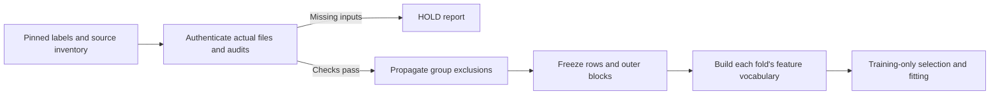

# Source admission and group partitions

Updated 2026-11-07. **The source admission stage now combines identifier correspondence, actual-file authentication, whole-group exclusions and deterministic outer blocks.** Its actual current result is **HOLD: 8/403 host files verified, 395 missing, and no completed target-host ANI audit**. It writes a source-check report without a final row roster or partition file. No biological fitting or target score has been generated.

## Identifier correspondence

All **402 model-table host IDs** map through the cross-checked original experimental table to **exact deposited source filenames**. This resolves the earlier 137 punctuation-only candidates at the identifier level: the original table supplies the matching source ID, rather than accepting a guessed alias. The [actual source-check report](../data/processed/genophi-training-roster-check/report.json) records each correspondence and file ID. Every record retains `stock_identity_verified: false`; file checksums and identifier correspondence do not establish experimental-stock identity.

The original [source-map artifact](../data/processed/genophi-training-source-map.json) remains unchanged as a record of the earlier direct-name audit. All 403 deposited hosts occur in the 404-node core-distance source matrix; its extra source node remains available as a grouping bridge. The 402 modelling hosts are a subset of that complete grouping.

## Whole-group exclusions

The [complete phage-group report](../data/processed/genophi-phage-groups.json) uses all **99 nodes and 4,851 unrounded pairs**, including target, excluded and nonmodel bridge nodes. Every pair is checked against the authenticated calculator output that passed direct original-R comparison. The fixed edge rule is similarity ≥69.99%, comprising the earlier 70% threshold and 0.01-point exclusion buffer. These are conservative grouping rules, not taxonomic or phenotype assignments.

| Graph scope | Components |
| --- | ---: |
| All 97 deposited representations and two target references | 24 |
| Groups containing the 94 modelling phages | 23 |
| Groups containing the 93 retained modelling phages | 22 |

The target-containing components and any component with a near-gp17 seed are excluded as whole groups. Source exclusions remain `427_P2` and `T7_Portugal`; only `427_P2` is in the 94-phage model roster. T3's target-only component also has exclusion status but contributes no model-table source. No boundary edges occurred in this dataset. Deposited terminal-repeat/length caveats remain unchanged.

Host target exclusions will similarly propagate from every near, boundary, unreported-comparison or named-target seed through complete host core-distance groups. This prevents another member of an excluded background from remaining in training. The source builder recomputes flags from the actual skani matrix and checks input lists, all 403 source hashes, target hashes, command parameters, executable, policy and wrapper bindings; report flags alone do not grant admission.

## Fixed outer-block rules

The [roster policy](../software/tipcraft/benchmarks/retro-t7-t3/genophi-roster-policy.json) fixes three host folds, three phage folds and seed 2027 before fitting. Group IDs are ordered by SHA-256 of `[seed, axis, group_id]`, then assigned cyclically. No label, sample-count or outcome optimization chooses the partitions. Insufficient groups or empty training/test blocks fail without a random fallback.

For each of the nine host/phage block combinations:

| | Held-out phage fold | Other phage folds |
| --- | --- | --- |
| Held-out host fold | Test | Embargo |
| Other host folds | Embargo | Train |

Thus neither held-out host groups nor held-out phage groups enter that block's training. Each retained pair appears in one outer test block across the full cross. The [partition implementation](../software/tipcraft/src/tipcraft/partition.py) reads sample metadata without labels; the source builder adds class-count diagnostics afterward. Single-class training must abstain, and undefined discrimination metrics remain undefined. These folds share the original experimental publication and are not leave-publication-out validation.

Final partitions are generated only after the complete source checks pass. Each fold still needs its **own training-only feature vocabulary, occurrence consolidation and supervised selection**. Neither the 93-phage pilot vocabulary nor the grouped split itself completes that preprocessing requirement.

## Actual current check

The builder independently replays the pinned label, core-host and complete-phage audits and authenticates actual genome bytes. Its current provisional row accounting excludes **649 unique rows**, with overlapping reasons retained: 156 original-source-empty pairs, 402 rows involving the excluded modelling phage, and 94 rows involving the known named-target host group. The apparent remainder of 37,139 rows is **not an admitted training set**; additional host exclusions are still unknown.

The output directory contains only `report.json`. `final_roster_written` and `production_run_spec_complete` are both false. Independent replay reproduced this report byte-for-byte and confirmed the absence of `rows.json` and `partitions.json`.



## Reproduction and next action

Run from the repository root with a fresh output directory:

```bash
uv run --project software/tipcraft python scripts/group-genophi-phages.py --policy software/tipcraft/benchmarks/retro-t7-t3/genophi-roster-policy.json --output /tmp/genophi-phage-groups.json
uv run --project software/tipcraft python scripts/build-genophi-training-roster.py --policy software/tipcraft/benchmarks/retro-t7-t3/genophi-roster-policy.json --metadata-cache data/raw/genophi-training-map --genomes data/raw/genophi-genomes --target-genomes data/raw/wish --phage-groups data/processed/genophi-phage-groups.json --output-dir /tmp/genophi-source-admission
```

The present second command exits **1** with an explicit HOLD report; that is the verified missing-input result. After importing the official host ZIP, run the [frozen host audit](13-genome-input-preparation.md#frozen-host-relatedness-triage) and supply its directory with `--host-audit-dir`. Successful source admission means `ready_for_feature_preparation`, not permission to skip the remaining model specification or evidence gates. New-method coverage remains 0/10, and the existing WIsH failure and four construct abstentions remain intact.
